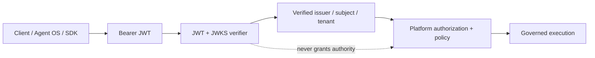

# M13.2 — Production Identity and Authentication

This phase adds a real cryptographic identity adapter to the governed Platform boundary. It does not move authorization into the identity layer.

## Verification profile

- JWKS-backed public-key verification through PyJWT.
- HTTPS is mandatory for issuer and JWKS endpoints.
- Allowed algorithms are explicit: RS256, PS256, ES256 and EdDSA; the token cannot select the allowed set.
- Issuer and audience are validated cryptographically and semantically.
- `exp`, `iat`, `iss`, `sub`, `jti`, `client_id` and a configured principal-type claim are required by the default access-token profile.
- `typ=at+jwt` and a non-empty `kid` are required by default; deployments may change the profile only through explicit configuration.
- Tenant identity is required from configured `tenant_id` or `tid` claims. If multiple configured aliases are present, they must agree exactly.
- Roles and scopes are normalized from signature-verified claims; contradictory `scope` and `scp` claims fail closed.
- Nonce binding is available when the calling authentication flow supplies an expected nonce.
- JWKS retrieval has a bounded timeout and cached key rotation; the token cannot select the key URL or allowed algorithms.
- `JWKSPrincipalResolver` binds verified identity to the Platform `Principal` contract and checks revocation by issuer plus `jti` before returning a principal.
- Revocation backend errors fail closed and are reported as authentication failures; the SQLite adapter is a durable single-host reference implementation, not a multi-instance production service.

These controls follow current JWT best practices: fixed algorithm allowlists, issuer/subject validation, audience validation, explicit typing where profiles need separation, and no trust in attacker-controlled key URLs.

## Authority boundary

A verified identity is still only an authenticated principal. It does not grant a capability, bypass policy, approve an action, or widen tenant scope. Authorization remains a separate Platform decision.

## Production boundary

The verifier is the cryptographic adapter. Production deployments still require an approved identity provider, hardened JWKS availability, key lifecycle/revocation operations, TLS trust configuration, monitoring, and incident response.

## Canonical P2 identity/tenancy hardening

The default verifier now applies a strict access-token profile, rejects contradictory tenant aliases, malformed NumericDate values, untrusted principal types, conflicting scope claims and malformed roles. The concrete resolver maps only verified claims to `Principal`; it never accepts caller-supplied identity as a substitute for token verification. The HTTP boundary returns 401 for invalid/revoked tokens and 403 when a valid principal attempts to assert another tenant or subject.

## Verification and remaining deployment evidence

Tests cover issuer/audience/algorithm/type/key ID, expiry/not-before/future-issued time, tenant claim presence and conflict, client ID, principal type, roles/scopes, revocation persistence across store re-instantiation, revocation-store outage fail-closed behavior, invalid signatures, and a real local HTTP boundary round trip. These are deterministic repository tests. Production still requires a shared durable revocation backend, a configured trusted issuer/JWKS endpoint, rotation and outage monitoring, production TLS/reverse-proxy configuration, and operational incident-response evidence.
