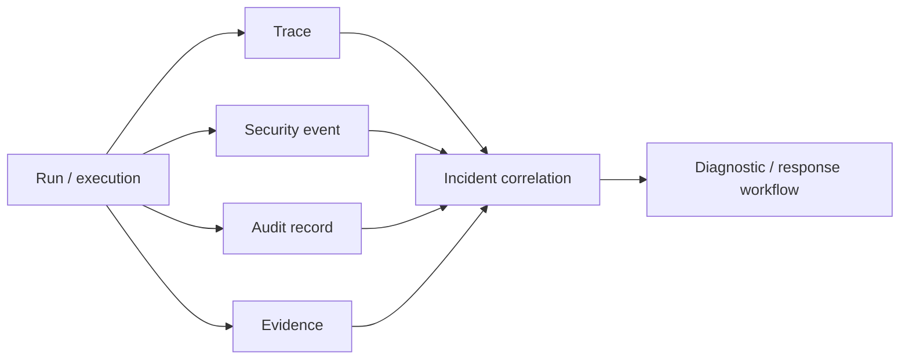

# M13.8 — Observability and Incident Correlation

M13.8 makes security-relevant telemetry causally useful without turning telemetry into authority.

## Invariants

- Tenant, run and execution identity remain correlation metadata, never authorization.
- Trace spans require normalized tenant/name and valid time ordering.
- Security events support trace, run, execution and incident correlation.
- Security events contain outcomes (allow, deny, error, unknown) and severity.
- Incident correlation groups identifiers rather than copying sensitive payloads.
- Telemetry must not contain secret material, bearer tokens, private keys or raw credential values.
- Production adapters should emit OpenTelemetry-compatible traces/metrics/logs and preserve W3C trace context at trust boundaries.
- Trace identifiers are normalized to W3C trace/span identifier formats before correlation.
- Incident correlation requires tenant binding for security events, audit records and evidence links; cross-tenant correlation fails closed.
- SLO/error-budget measurement remains operational governance and never grants execution authority.

The controls directly address OWASP MCP Top 10 MCP08 (lack of audit/telemetry) and NIST's agent-security emphasis on attributable auditing.

## Production OpenTelemetry adapter

`OpenTelemetryObservabilitySink` accepts the application's configured OpenTelemetry tracer, meter and logger objects. The application remains responsible for configuring SDK providers, OTLP exporters, resource identity, sampling, collector endpoints, TLS/authentication, retention and alert routing.

- Completed spans are exported with start/end timestamps and tenant/run correlation attributes.
- When a W3C trace ID is supplied, a context factory is mandatory. The application must build the proper OpenTelemetry parent/root context; the adapter does not fabricate or silently drop parent context.
- Metrics use histograms, cache instruments by name, reject unit changes for an existing name, cap instrument creation at 64 by default (hard maximum 256), and deliberately omit tenant IDs as metric dimensions to limit cardinality.
- Security events are emitted as structured OTel log records with tenant, actor, trace, run, execution, incident, severity and outcome correlation. Secret payloads are not accepted or copied.
- The in-memory sink remains useful for tests; it is not a production telemetry backend.

This adapter provides the instrumentation bridge, not production observability acceptance. FCP-03 still requires configured exporters/collectors, durable retention, redaction review, dashboards, security-event correlation, SLOs, alerts, incident response, operational ownership and failure-mode testing.
